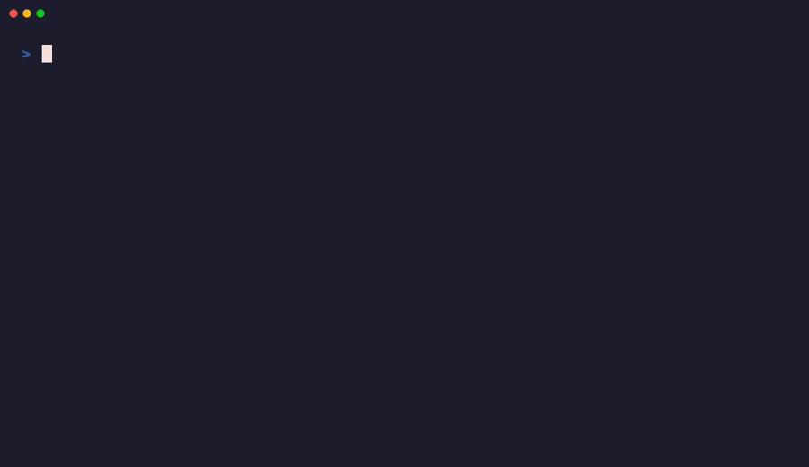

<div align="center">

# 🦊 FoxVC

**An ultra-embeddable, zero-dependency C scripting language and bytecode VM with 25 deterministic keywords.**

[](LICENSE)
[](https://anayupadhyay-all.github.io/FoxVC/)
[](#-verification--tests)
[](FOXVC_SPEC.md)
[](FOXVC_CHANGELOG.md)
[](#-one-line-install)

<br/>

### [▶ Try FoxVC Live in Your Browser (No Install Needed)](https://anayupadhyay-all.github.io/FoxVC/)

*Runs 100% client-side via WebAssembly. Zero installation, zero server dependencies.*

<br/>

</div>

---

## 🎬 Hero Showcase

```text
┌───────────────────────────────────────┐  ┌───────────────────────────────────────┐
│           main.fox (Code)             │  │          Terminal (Execution)         │
├───────────────────────────────────────┤  ├───────────────────────────────────────┤
│ act fib(n)                            │  │ $ foxvc build main.fox -o fib_app     │
│     lock a = 0                        │  │ 📦 Built native executable (14.6 KB)  │
│     lock b = 1                        │  │ ⚡ Zero-dependency standalone binary   │
│     shift i = 0                       │  │                                       │
│     spin i < n                        │  │ $ ./fib_app                           │
│         lock temp = a + b             │  │ Computing 100k iterations...          │
│         a = b                         │  │ Result: 55                            │
│         b = temp                      │  │ [Benchmark: 0.18 ms]                  │
│         i = i + 1                     │  │                                       │
│     emit a                            │  │                                       │
│                                       │  │                                       │
│ say fib(10)                           │  │                                       │
└───────────────────────────────────────┘  └───────────────────────────────────────┘
```

<p align="center">
  
</p>

---

## ⚡ Why FoxVC?

* **Zero-Dependency Footprint:** The entire bytecode runtime (`engine/foxvm.c`) is written in compact, portable C89/C99. It compiles into a **14 KB standalone executable** linking only `libc` and `libm`.
* **Deterministic 25-Keyword Grammar:** No hidden syntax traps, no confusing inheritance hierarchies, and no bloated keyword catalogs. Exactly 25 official keywords govern the entire language specification.
* **Dual-Tier VM Architecture:** Rapid prototyping via a tree-walking interpreter, combined with blazing-fast bytecode dispatch in the compact C virtual machine (`foxvm.c`).
* **First-Class Mobile Support:** Native offline execution and on-device ARM64 compilation inside Android Termux, plus a touch-native Mobile Studio IDE.
* **Instant In-Browser WASM:** Runs natively inside any modern browser with WebAssembly compiled via Emscripten.

---

## 🔍 Syntax at a Glance

```fox
# 1. Variables: lock (immutable) and shift (mutable)
lock app_name = "FoxVC Arena"
shift score = 0

# 2. First-class functions (act) and explicit return signals (emit)
act calculate_bonus(points, multiplier)
    lock bonus = points * multiplier
    emit bonus

# 3. Branching: pick / alt / otherwise (pattern evaluation)
pick score > 100
    say "Rank: Grandmaster"
alt score >= 50
    say "Rank: Challenger"
otherwise
    say "Rank: Initiate"

# 4. Deterministic loops: spin (while condition) and cycle (count)
spin score < 30
    score = score + 10
    say "Progress Score: " + score

lock final_payout = calculate_bonus(score, 2)
say "Final Payout: " + final_payout
```

---

## 🛠 Architecture Pipeline

```text
                           ┌───────────────────────────┐
                           │    Source Code (.fox)     │
                           └─────────────┬─────────────┘
                                         │
                                         ▼
                           ┌───────────────────────────┐
                           │   Token Lexer (lexer.py)  │
                           └─────────────┬─────────────┘
                                         │
                                         ▼
                           ┌───────────────────────────┐
                           │   AST Parser (parser.py)  │
                           └─────────────┬─────────────┘
                                         │
                                         ▼
                           ┌───────────────────────────┐
                           │ Bytecode Compiler (AOT)   │
                           └─────────────┬─────────────┘
                                         │
                 ┌───────────────────────┴───────────────────────┐
                 │                                               │
                 ▼                                               ▼
   ┌───────────────────────────┐                   ┌───────────────────────────┐
   │    Native Desktop / OS    │                   │   Browser / WebAssembly   │
   │    foxvm.c  (GCC/Clang)   │                   │   wasm_bridge.c  (EMCC)   │
   │    14 KB Standalone ELF   │                   │   Client-Side Web Engine  │
   └───────────────────────────┘                   └───────────────────────────┘
```

---

## 📦 One-Line Install

### Linux, macOS, and Android (Termux)
Paste this single command into your terminal:

```bash
curl -sSL https://raw.githubusercontent.com/AnayUpadhyay-all/FoxVC/main/install.sh | bash
```

### Manual Build
```bash
git clone https://github.com/AnayUpadhyay-all/FoxVC.git
cd FoxVC
bash install.sh
```

---

## 🚀 Quickstart Commands

```bash
# 1. Run any .fox script directly
foxvc run examples/hello.fox

# 2. Compile to a standalone, zero-dependency native executable binary
foxvc build examples/math.fox -o math_app
./math_app

# 3. Canonical Auto-Formatting (enforces 4-space indentation)
foxvc fmt . -w

# 4. Static Code Linter (checks unused variables & safety rules)
foxvc lint .

# 5. Native Automated Test Runner
foxvc test tests/

# 6. Start Language Server Protocol daemon for VS Code & Cursor
foxvc lsp

# 7. Launch the local Mobile / Web Touch Studio (port 8080)
foxvc mobile
```

---

## 📖 The 25 Official Keywords

FoxVC guarantees language identity stability: **these 25 keywords are permanent.**

| Category | Keywords | Purpose |
| :--- | :--- | :--- |
| **Functions & Return** | `act`, `emit` | Function definitions and explicit value return signals |
| **Data Structures** | `pack`, `mold` | Data dictionaries, arrays, and structured blueprint templates |
| **Branching** | `pick`, `alt`, `otherwise` | Deterministic control-flow branching and pattern matching |
| **Loops** | `pulse`, `cycle`, `spin` | Game tick pulse loops, finite count cycles, and conditional loops |
| **Loop Control** | `halt`, `skip` | Loop termination (break) and next iteration (continue) |
| **I/O & Communication** | `say`, `ask` | Standard output printing and interactive user input |
| **Safety & Traps** | `guard`, `trap` | Condition assertion guards and recovery traps |
| **Modules** | `fuse` | Isolated hybrid module imports and standard library shelves |
| **Variables** | `lock`, `shift`, `blank` | Immutable constants, mutable variables, and nil values |
| **Booleans & Logic** | `aye`, `nay`, `also`, `either`, `deny` | Native boolean truth, falsehood, and logical operators |

---

## 🗺 Roadmap

| Milestone | Target | Description | Status |
| :--- | :--- | :--- | :---: |
| **Milestone 1** | Language Core | 25-keyword grammar, lexer, AST parser, and bytecode VM | ✅ Completed |
| **Milestone 2** | Runtime Hardening | Hybrid module isolation (`fuse`), shelves, structured diagnostics | ✅ Completed |
| **Standalone Compiler** | `foxvc build` | Single-binary compiler producing ~15 KB native ELF/PE binaries | ✅ Completed |
| **Mobile Studio** | Android Termux | PWA touch-interface, quick-insert keyboard toolbar, ARM64 engine | ✅ Completed |
| **WebAssembly** | GitHub Pages | In-browser zero-install playground compiled via Emscripten | ✅ Completed |
| **Developer Tooling** | `fmt` & `lint` & `test` | Canonical 4-space auto-formatter, static analysis linter, and native test runner | ✅ Completed |
| **Language Server** | `foxvc lsp` | Full JSON-RPC 2.0 LSP daemon with real-time squigglies, autocomplete & hover | ✅ Completed |
| **CVM 2.0 Native Parity** | Pure C Objects | Native struct member allocation & lookups on 8MB linear arena in `foxvm.c` | ✅ Completed |
| **Standard Shelves** | `data`, `audio`, `socket` | Native CSV/JSON/TOML, PCM WAV audio synthesis, and raw WebSocket framing | ✅ Completed |
| **IDE Extension** | VS Code / Cursor | Official FoxVC marketplace extension with language client and TextMate grammar | ✅ Completed |

---

## 🤖 Code with Any AI (ChatGPT, Claude, Cursor)

You don't need to learn FoxVC alone. FoxVC is **100% AI-First and LLM-ready**. 

You can give the language specification directly to **ChatGPT, Claude, Cursor, Gemini, or Copilot**, and your AI will immediately understand the syntax, write idiomatic FoxVC code, and guide you through your first project!

### 1-Click AI Starter Prompt:
Copy and paste this into any AI:
```text
You are an expert FoxVC engineer. Read the official language specification here:
https://raw.githubusercontent.com/AnayUpadhyay-all/FoxVC/main/llms.txt
Full API reference: https://raw.githubusercontent.com/AnayUpadhyay-all/FoxVC/main/llms-full.txt

Please teach me FoxVC step-by-step and help me write my first project!
```

* 📄 **[llms.txt](llms.txt)** — Concise AI context specification.
* 📚 **[llms-full.txt](llms-full.txt)** — Complete reference manual with all 10 shelves and APIs.
* 📐 **[GRAMMAR.md](GRAMMAR.md)** — Formal EBNF grammar rules and syntax structures.

---

## 🤝 Contributing to FoxVC

FoxVC is an independent, community-driven project. We welcome developers of all skill levels!

Because FoxVC is clean, compact, and deterministic, **you can learn the architecture and contribute your first standard shelf in an afternoon**.

* 🚀 **[CONTRIBUTING.md](CONTRIBUTING.md)** — How to set up, test, and contribute.
* 📦 **[How to Build a Shelf in 10 Minutes](docs/HOW_TO_CREATE_A_SHELF.md)** — Step-by-step tutorial to add new libraries.
* 🏷️ **Good First Issues:** Search our repository issues for `good first issue` to pick up beginner-friendly tasks (regex shelf, base64 encoding, tutorials, and editor themes).

---

## 📄 License

FoxVC is open-source software licensed under the [MIT License](LICENSE).
